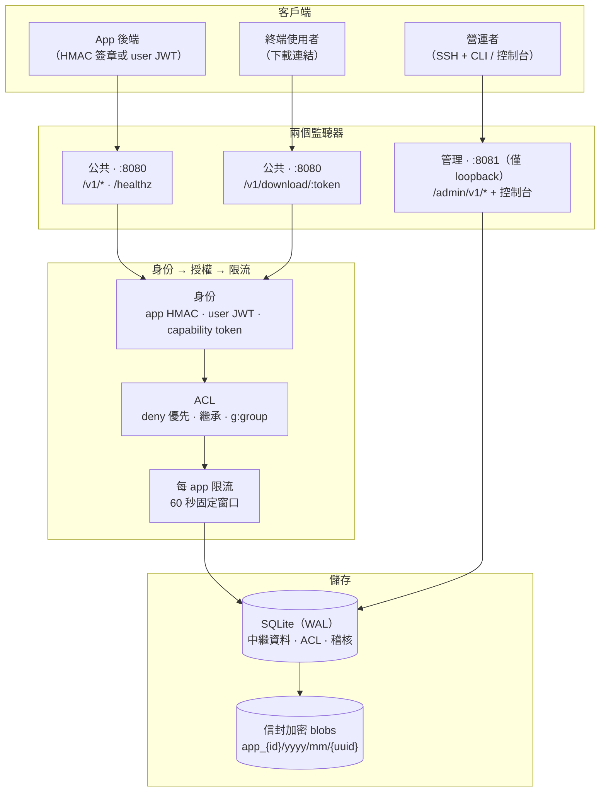

# Tenant FS Server（多租戶檔案儲存服務）— 繁體中文

> 本頁為繁體中文版。English: [`../../README.md`](../../README.md)
> 這是一份「多租戶、多 app」的檔案儲存服務，以 Rust（Axum）撰寫，強調 app 之間、
> 使用者之間的資料與存取權**嚴格隔離**——適合為 SaaS / PaaS 後端儲存各種可能敏感的
> 檔案（財務發票、文件、圖片…）。

---

## 它能做什麼

- **租戶模型**：Account → App → User。每個 App 各自擁有自己的 `app_key` /
  `app_secret`、配額（quota）、blob 空間與資料夾樹。`user_id` 是由 App 指定的
  不透明識別碼，在**該 App 內**唯一。
- **上傳 / 下載 / 連結 API**：帶簽章的 app 請求、能力型（capability）下載權杖、
  Range 支援、ETag / 304。
- **處處隔離**：
  - 實體 blob：`/blobs/app_{id}/yyyy/mm/{uuid}`——無副檔名、位於 web 根目錄之外、
    防路徑逃逸（canonicalize + `starts_with(app_root)`）。
  - 權杖：能力型權杖，綁定「app + 檔案 + 可選 IP」，具 TTL、可即時撤銷，且有冪等的
    embed 視窗（TTL 內重複產生回傳相同權杖，除非已撤銷）。
  - ACL：支援檔案與資料夾層級、分動作（read / write / delete / list / export）、
    資料夾繼承、**deny 優先於一切**、owner 預設存取權、`"*"` 萬用字元、
    `public_read`，以及 `g:<group>` 群組參照（群組透過 admin API /
    `filesrv-cli admin group …` 管理）。
  - 請求：`X-App-Key` + 對 `method\npath\nquery\nbody_hash\nts\nonce`
    的 HMAC-SHA256 簽章、±300 秒時間戳視窗、一次性 nonce（重放防護）、常數時間比較。
  - 使用者身分**只**來自以 App 密鑰簽署的 user-context JWT（`iss = app:{id}`）；
    請求 body／header 中的任何 `user_id` 都不會被信任。
  - Admin API 只綁定本機（loopback），以 bearer token 驗證。
- **持久化**：以 SQLite（WAL）為權威儲存 + 磁碟上的實體 blob 檔案。所有狀態在重啟後
  仍存在。不需要 Redis / PostgreSQL。
- **營運**：app 生命週期（建立／停用／輪換密鑰／刪除）、用量指標、稽核日誌、
  完整 app 匯出（tar 或 zip）、payload / 配額上限。
- **靜態加密**：blob 採信封加密（每個 blob 隨機 DEK，以由 `TENANT_FS_SERVER_SECRET`
  衍生的 KEK 密封；含自描述的 `TSFS` 檔頭）。舊版明文 blob 可透明讀取。
  密鑰**永不**寫入備份。
- **軟刪除寬限期**：`DELETE` 會標記 tombstone、立即回收配額並撤銷權杖；blob 在寬限期
  （預設 7 天）後由背景迴圈實體清除。
- **內建備份**：`POST /admin/v1/backups/run` 對 DB 做快照（`VACUUM INTO`）+ 以
  sha256 manifest 封存加密的 blob 樹；支援可設定的保留份數、排程、以及
  `data/backups` 下的目標白名單。還原是營運端手動程序。
- **分塊 / 可續傳上傳**：`init` → 帶 `X-Chunk-Offset` 的 `PUT` → `finalize`，
  強制連續偏移（409 + 續傳偏移）、TTL 清理。
- **每 app 限流**：generate / upload / export（含分塊呼叫）共用 60 秒固定視窗；
  超過回 `429` + `Retry-After`。
- **冪等上傳**：可選的 `Idempotency-Key`，在可設定視窗內重複呼叫回傳快取結果。
- **管理控制台**：管理埠上的小型 loopback-only HTML/JS 儀表板，純 client-side bearer
  驗證，帶加固的 CSP / frame-deny / no-store 檔頭。

---

## 運作流程



App 與使用者請求落在公共監聽器上，先解析身份、再經 ACL 引擎（deny 永遠優先、
資料夾繼承）、最後依 app 限流，之後才觸及儲存。下載是另一條路徑：capability token
自行驗證（不需 app key）。營運面是第二個僅限 loopback 的監聽器，以 bearer token
保護。

## 快速開始

前置需求：Rust 工具鏈（編譯用）、`sqlite3` 與 `openssl`（供 `setup-env.sh`）。
支援 Linux 與 macOS。

```bash
cd rust-file-server
# 1) 由 .env.example 產生 .env，隨機填入 SERVER_SECRET + ADMIN_TOKEN（mode 600）。
#    具冪等性：絕不覆寫既有的 .env。
./scripts/setup-env.sh
# 2) 檢視 / 調整設定（連接埠、配額、保留份數…）
nano .env
# 3) 載入 .env 並啟動 release 執行檔
./scripts/start.sh
```

伺服器會啟動兩個監聽器：

- **公共 API** 於 `0.0.0.0:8080`——`/v1/*`、`/healthz`、`/.well-known/security.txt`
- **管理 API + 控制台** 於 `127.0.0.1:8081`——僅限本機 loopback

開啟管理控制台 `http://127.0.0.1:8081/admin/`，用 `.env` 中的
`TENANT_FS_ADMIN_TOKEN` 登入，然後 **Create App**。控制台會顯示回傳的
`app_key` / `app_secret`——請把密鑰保存在伺服器端。使用者可從控制台（「Users」）
或 admin API 依 app 預先佈建。

或用 API 建立 App：

```bash
curl -X POST http://127.0.0.1:8081/admin/v1/apps \
  -H "Authorization: Bearer $TENANT_FS_ADMIN_TOKEN" \
  -H "Content-Type: application/json" \
  -d '{"name":"my-app","quota_bytes":10737418240,"max_payload_bytes":104857600}'
```

App-facing API 參考：[`en/api.md`](../en/api.md) / [`zh/api.md`](api.md)。
Admin API（僅 loopback：apps / users / audit / backups / console）：
[`development/admin-api.md`](../../development/admin-api.md)。Linux 生產部署
（systemd + Caddy TLS、非 root 加固）：[`en/deploy.md`](../en/deploy.md) /
[`zh/deploy.md`](deploy.md)。

---

## Admin CLI（透過 SSH）

管理員要在 shell（例如透過 SSH）管理伺服器時，專用的命令列前端隨附於
`scripts/filesrv-cli.sh`。它會從 `.env`（或 `TENANT_FS_ADMIN_TOKEN`）讀取權杖與
端點，因此在專案目錄下可直接執行：

```bash
sh scripts/filesrv-cli.sh --help                       # 列出所有指令
sh scripts/filesrv-cli.sh health                       # 非敏感：/healthz
sh scripts/filesrv-cli.sh admin apps                   # 列出 apps
sh scripts/filesrv-cli.sh admin app create my-app --quota 1GiB --max-file 64MiB
sh scripts/filesrv-cli.sh admin app rotate-secret 1
sh scripts/filesrv-cli.sh admin user add 1 alice@example.com
sh scripts/filesrv-cli.sh admin audit --since 86400
sh scripts/filesrv-cli.sh admin backup run && sh scripts/filesrv-cli.sh admin backup list
```

管理操作位於 `admin` 命名空間下，需要 admin token；`health` 與 `version` 非敏感、
不需 token。主機上需要 `curl` 與 `jq`（或 `python3`）。此 CLI 適用於伺服器本身
（admin API 僅 loopback）；若要從他處連到可達的管理端點，請使用 `--admin-bind` /
`--token`。

當 `filesrv-cli.sh` 在互動式終端執行、且尚未設定 `filesrv` shell alias 時，它會
主動提議新增，讓你之後能直接輸入 `filesrv admin …`。此動作發生在指令執行後
（無指令呼叫時也會）。回答 `Y` 會把 `alias filesrv=sh <絕對路徑>` 寫入你的 shell
rc 檔（zsh 為 `~/.zshrc`，bash 為 `~/.bashrc`）並提示你重啟 shell。此提示只會在
互動式終端出現——在 script、pipe、CI 中會略過——一旦 alias 設定完成即不再出現。

---

## 驗證

```bash
cargo test          # 73 tests: 37 unit + 36 integration
cargo clippy --lib  # 0 warnings（測試檔僅有 dead-code 警告）
```

整合測試涵蓋：跨租戶隔離、配額強制、ACL 繼承 + deny 優先（含繼承 deny 對上檔案層級
顯式 ACL）、權杖冪等／撤銷／IP 綁定、X-Forwarded-For 偽造拒絕、重放與偽造簽章拒絕、
路徑穿越、Range/ETag、程序重啟後的持久化、密鑰輪換、app 匯出（tar + zip）、批次 ACL、
payload 上限、稽核、未簽章上傳的早期拒絕、信封 blob 加密（讀舊／寫新）、軟刪除寬限期 →
清除、分塊上傳、備份 run / list / detail / config（含目標逃逸）、每 app 限流 429 +
Retry-After、HEAD 下載檔頭 / 404、冪等鍵重用、以及匯出 TTL 清理。

另曾執行真實 socket 的端到端冒煙測試：121/121 檢查通過（admin 驗證、上傳、embed
權杖重用、Range 下載、撤銷 → 404 → 新權杖、跨租戶 404、偽造 HMAC 401、nonce 重放
401、用量 + 稽核、IP 綁定 share 權杖對上真實 peer IP、XFF 偽造被擋、繼承-deny 回歸、
信封加密讀舊／寫新、軟刪除生命週期、備份 API、分塊上傳、限流、HEAD、zip 匯出、冪等、
匯出 TTL、loopback 管理控制台）。

注意：伺服器**預設忽略** `X-Forwarded-For`，IP 綁定權杖與稽核使用 TCP peer IP；
僅在受信任、且會覆寫該檔頭的反向代理後方才設定 `TENANT_FS_TRUST_XFF=true`。
啟動時會清理殘留的 `tmp_*` blob；背景維護迴圈（每 `TENANT_FS_PURGE_INTERVAL_SECS`，
預設 600 秒）會清除過期的 nonce、舊稽核列（`TENANT_FS_AUDIT_RETENTION_DAYS`）、
過期的 `tokens`、超過寬限期的軟刪除 tombstone、超過 TTL 的已完成匯出、中斷的分塊上傳
工作階段，以及超過 `TENANT_FS_DEC_CACHE_TTL_SECS`（預設 86400）的明文解密快取
（詳見 `Ops-and-Backup.md`）。

其他加固旋鈕：

- `TENANT_FS_ALLOW_NON_LOOPBACK_ADMIN`（預設 `false`）——當 admin bind 非 loopback
  時，除非明確設定此變數，伺服器**拒絕啟動**。
- `TENANT_FS_DEV_ALLOW_DEFAULT_SECRETS`（預設 `false`）——當
  `TENANT_FS_SERVER_SECRET`／`TENANT_FS_ADMIN_TOKEN` 仍是 dev 預設值時，伺服器
  **拒絕啟動**，除非設此僅供開發的逃逸口。生產環境切勿設定。
- `TENANT_FS_AUDIT_DOWNLOADS`（預設 `false`）——選用：為每次成功下載
  （`GET /v1/download/:token`）記錄稽核列，為敏感檔案提供逐次下載軌跡。
- 下載也計入與上傳 / generate / export 相同的每 app 限流預算
  （`TENANT_FS_RATE_LIMIT_PER_MIN`）。
- 使用者由營運端透過 `POST /admin/v1/apps/{id}/users` 佈建（也可在管理控制台的
  「用戶」按鈕操作）；含路徑分隔符 / `..` / 控制字元的使用者 id 在上傳與 admin 都會被拒。

---

## 目錄結構

```
scripts/
  setup-env.sh     generate .env from .env.example with random secrets (idempotent)
  start.sh         load .env and start the release binary
  backup.sh        optional whole-`data/` snapshot to a path you specify
  filesrv-cli.sh    shell front-end (SSH): filesrv-cli admin … / health / version
.env.example       template of all TENANT_FS_* settings (commented, safe defaults)
SECURITY.md        支援的版本 + 漏洞回報方式
LICENSE            專有授權 — 保留所有權利（閉源）
Documents/
  en/              English docs: api.md (app-facing), deploy.md, maintenance.md
  zh/              繁體中文 docs: api.md, deploy.md, maintenance.md,
                   Ops-and-Backup.md, maintenance-runbook.md, README.md
development/
  admin-api.md     loopback admin API: apps / users / audit / backups / console
  (规划/测试报告)     internal planning & test reports
src/
  main.rs         two listeners: public + admin (localhost), maintenance loop
  lib.rs          build_app(cfg) -> routers
  config.rs       env configuration (Config + Ops knobs)
  crypto.rs       HMAC, JWT (HS256), AES-256-GCM, sha256, constant-time cmp,
                  blob envelope encryption (KEK/DEK)
  db.rs           SQLite schema + queries (WAL, FK, nonce, audit, export jobs,
                  backups, upload jobs, settings, pruning)
  storage.rs      blob dir layout + path-escape-proof resolver + plaintext migration
  authz.rs        Identity, actions, ACL engine, folder inheritance
  tokens.rs       embed/share/revoke/verify capability tokens
  auth.rs         app HMAC + user JWT + admin verification
  ratelimit.rs   per-app fixed-window limiter (429 + Retry-After)
  idem.rs         Idempotency-Key cache (LRU)
  upload.rs       chunked-upload session state
  backup.rs       backup run (VACUUM INTO + blobs.tar + sha256 manifest), retention,
                  target whitelist
  admin_ui.rs     embedded loopback admin console assets (CSP / frame-deny / no-store)
  routes/         app.rs (files/folders/acl/batch/export/upload), admin.rs (apps/audit/
                  backups), download.rs
tests/
  integration.rs  full API tests
```

---

## 安全模型（摘要）

L1：App key 的作用域把每個請求綁定到單一租戶；L2：下載使用伺服器產出的能力型權杖
（刻意不引入 IdP / OIDC）。Blob 的存取由檔案中繼資料的 ACL 把關，**絕不**依賴路徑
字串解析。Deny 規則會沿整個資料夾鏈累積且永遠優先。權杖有期限；過期／已撤銷的權杖
回傳 404；被撤銷的 embed 槽位會在下一次 generate 時產生新權杖。

關於備份 / 合規主題（blob 信封加密、金鑰政策、內建備份 API、保留／排程、還原程序、
稽核保留），請參閱 [`Ops-and-Backup.md`](Ops-and-Backup.md)、admin API 的
[`development/admin-api.md`](../../development/admin-api.md)，以及 App-facing 的
[`en/api.md`](../en/api.md) / [`zh/api.md`](api.md)。
